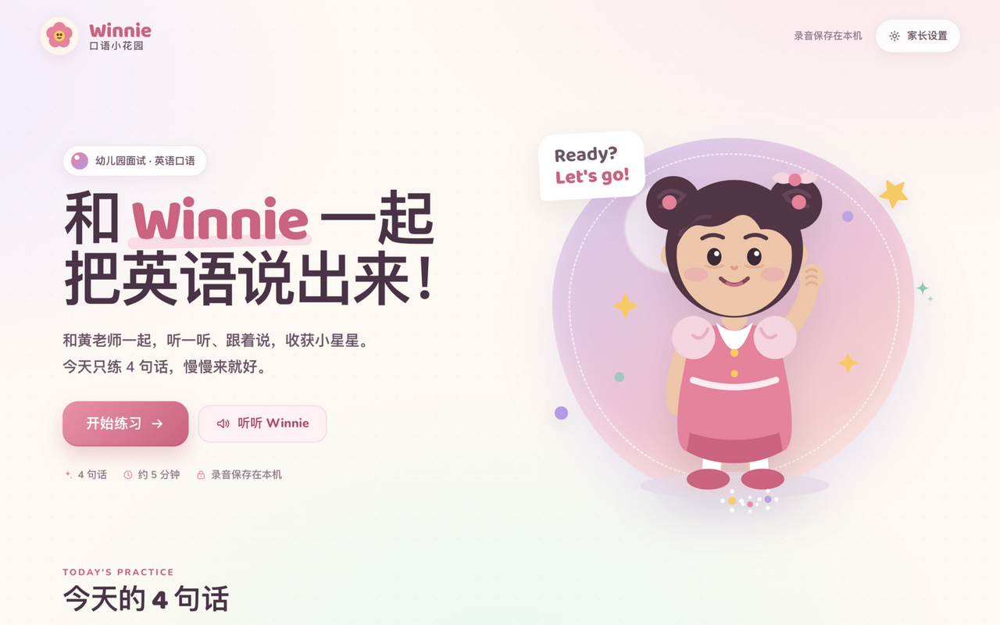
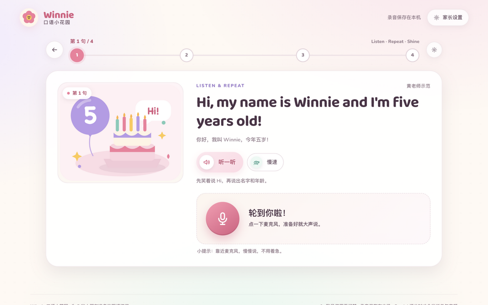
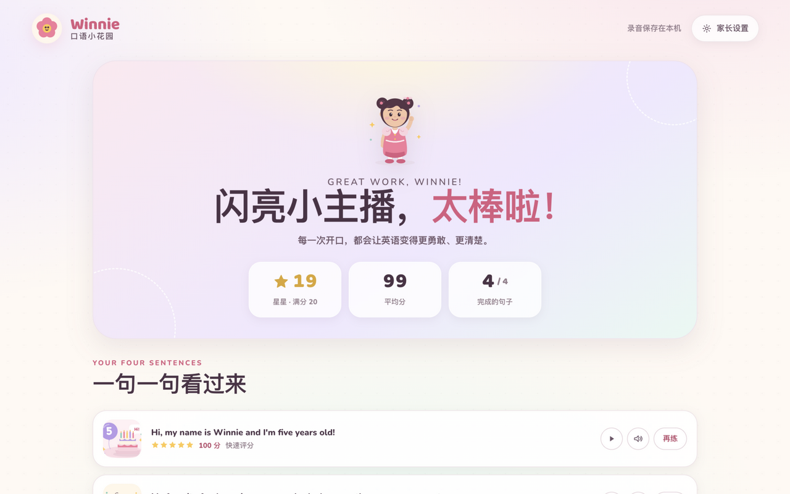
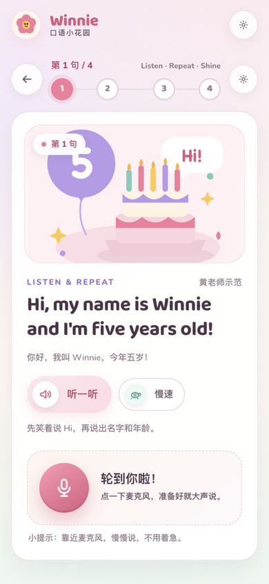
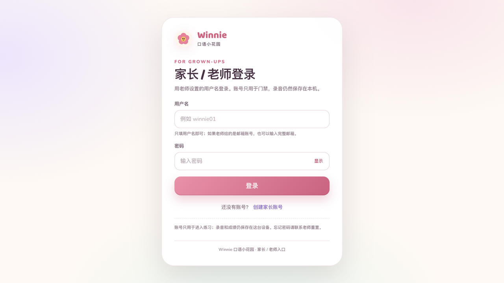
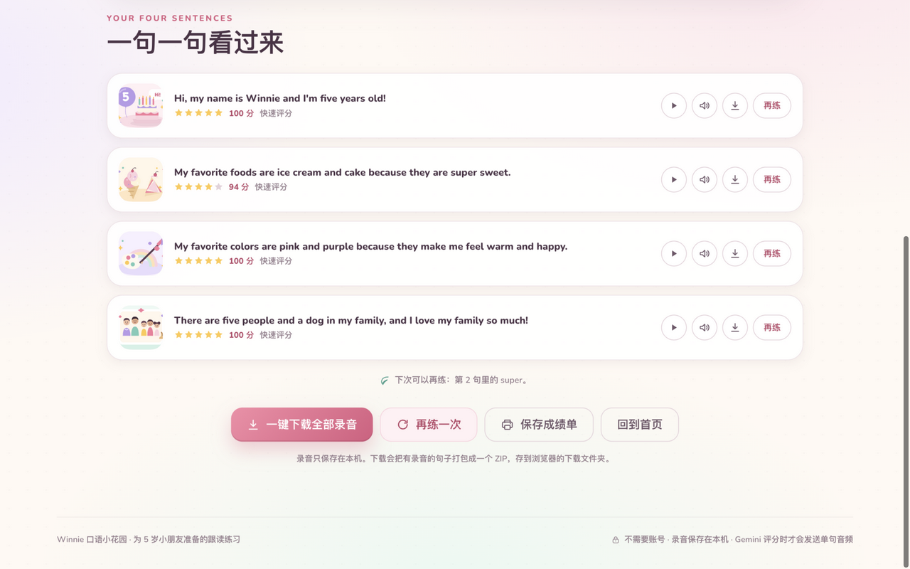

# Winnie 口语小花园

给 5 岁小朋友做的幼儿园面试英语跟读练习。听 Winnie 说一句，点麦克风跟读，马上得到星星和逐词反馈；四句话练完有一张可以打印的小成绩单。

- **4 句面试自我介绍**：名字和年龄、喜欢的食物、喜欢的颜色、家人和小狗
- **自然示范音**：黄老师 / 小伙伴两种神经语音，每句还有慢速版
- **真实录音**：录音、回放、重录；录音和成绩保存在本机
- **账号门禁**：Supabase 用户名 + 密码登录；账号只用于进入，不改变本机录音
- **两种评分**：无需 Key 的本机快速评分；填入 Gemini 免费 API Key 后得到发音、流利度、完整度和逐词点评
- **一键下载**：每句单独下载，或在最后把全部录音打包成 ZIP
- **儿童友好界面**：大按钮、粉紫花园配色、星星动画、中文鼓励语；家长设置单独收纳

## 预览

| 首页 | 练习页 |
| --- | --- |
|  |  |

| 成绩单 | 手机练习页 |
| --- | --- |
|  |  |

| 登录门禁 | 一键下载录音 |
| --- | --- |
|  |  |

## 快速开始

不需要构建，直接起一个本地静态服务器：

```bash
cd winnie-speaking
./serve.sh 4173
```

打开 <http://localhost:4173>。

> 默认会先看到 Supabase 登录门禁。还没配置 Supabase 时，可以先把 `assets/auth-config.js` 的 `enabled` 改成 `false` 预览练习；配置完成、上线前再改回 `true`。

也可以手动：

```bash
python3 -m http.server 4173
```

> **不要直接双击 `index.html`。** 浏览器要求麦克风只能在 `localhost` 或 `https` 下使用。
> 推荐 Chrome / Edge；Safari 也能录音，但本机听写需要 Chrome / Edge（见下方浏览器支持）。

### 无麦克风预览

```text
http://localhost:4173/?demo=1
```

演示模式会用内置的 `demo-*.wav` 模拟一次录音，不需要麦克风权限。第 2 句故意把 “super” 说成 “really”，用来展示漏词和 4 星反馈。

## 登录门禁（Supabase，用户名 + 密码）

默认开启。第一次打开如果看到「登录还没配置」，说明还没有填 Supabase；这是正常的配置页，不是故障。

- 页面上的登录标识是**用户名**，但 Supabase Auth 本身按邮箱识别用户。应用会在后台把 `winnie01` 映射成 `winnie01@students.winnie-garden.app` 这样的**合成邮箱**；这个地址不会收信，页面上也不会显示。
- 登录成功后，右上角显示用户名；「家长设置」里可以退出登录。
- 账号只用于门禁。录音、成绩仍保存在当前设备的 IndexedDB，不会因为登录而同步到云端。

### 配置步骤

1. 在 [Supabase](https://supabase.com) 新建项目。
2. 打开 **Authentication → Providers → Email**，启用 Email，并关闭 **Confirm email**。  
   因为合成邮箱收不到确认信；如果保持开启，新注册的账号会停在未确认状态。
3. 打开 **Project Settings → API**，复制 **Project URL** 和 **anon public key**，填到 `assets/auth-config.js`：

```js
window.WINNIE_AUTH = {
  enabled: true,
  supabaseUrl: "https://xxxx.supabase.co",
  supabaseAnonKey: "eyJ...",
  usernameDomain: "students.winnie-garden.app",
  allowSignUp: true
};
```

4. 在 **Authentication → URL Configuration** 里把站点地址加到 Site URL / Redirect URLs（本地开发同时加 `http://localhost:4173`）。
5. 刷新页面，用用户名和密码登录。

### 账号怎么创建

- **允许自助注册**（默认）：`allowSignUp: true`，登录页显示「创建家长账号」；用户名规则为 2–32 位字母、数字、点、下划线或短横线。
- **由老师统一建号**（推荐班级使用）：在 Supabase **Authentication → Users → Add user** 创建，邮箱填 `用户名@students.winnie-garden.app`，设置密码并勾选自动确认；也可以关闭 Supabase 的公开注册，并把 `allowSignUp` 改为 `false`，隐藏注册入口。
- 忘记密码：目前不支持自助邮件找回（合成邮箱收不到信），老师在 Supabase 后台重置密码。
- 一旦已有账号，不要随意修改 `usernameDomain`，否则旧账号会找不到对应的合成邮箱。

### 安全说明

- 这是**界面门禁**，静态 HTML/JS 本身仍然是公开文件；不要用它保护秘密内容。以后如果把成绩上云，用 Supabase 的 RLS 和教师/学生角色做真正的数据权限。
- `anon public key` 可以公开；**不要**把 `service_role` key 或 Gemini/OpenAI Key 写进 `auth-config.js`。
- 登录门禁不会让 Gemini Key 变安全：当前 Gemini Key 仍然由家长设置保存在本机浏览器。要让全班共用一把服务端 Key，需要另加 Vercel Function 代理（当前版本未内置）。
- 只想本地预览、暂时不登录：把 `assets/auth-config.js` 的 `enabled` 改成 `false`；上线前务必改回 `true`。

## 怎么练

1. **听**：进入每一句会自动播放示范音；也可以随时点「听一听」，或用「慢速」再听一遍。
2. **说**：点红色麦克风开始录音，说完点「说完了」（或者再点一次麦克风）。最长 20–22 秒，自动停止。
3. **看星星**：录音优先转成 16 kHz WAV 保存；随后显示播放器和评分卡。
   - 本机模式：比较听到的单词与原文，显示「听辨准确度 / 节奏 / 完整度」。
   - Gemini 模式：把这一句录音和原句发给 Gemini，听发音、流利度和完整度。
4. **再来一次 / 下一句**：每句可无限重录；四句结束进入成绩单，可保存为 PDF、打印，或一键下载全部录音。

## 下载录音

练习结束后有三种下载方式：

- **结果卡**：每句录音旁边有「下载」，保存为单个 WAV。
- **成绩单每一行**：播放、示范、下载三个小按钮，单独下载那一段。
- **一键下载全部录音**：成绩单底部的玫瑰色按钮。会把所有已有录音和一份 `README.txt` 打包成 `Winnie_recordings_YYYY-MM-DD.zip`，文件名形如 `Winnie_01_name.wav`。
- `README.txt` 里会列出四句原文和每句得分，方便家长留存。
- 下载文件来自本机 IndexedDB，不经过服务器；录音本来就是 16 kHz WAV，所以 ZIP 不额外压缩，解压即用。
- 如果浏览器拦截了多文件下载，使用 ZIP 按钮即可；逐个下载也可以在每句旁边完成。

## AI 评分怎么开

孩子端统一称呼为“黄老师”；家长设置里仍然使用“Gemini / AI 评分”这样的技术名称。

### 只用本机快速评分（不需要任何 Key）

Chrome / Edge 会在录音时用浏览器的 Web Speech API 做实时听写，然后把转写和原句逐词比较。它不评价口音，但完全够用来检查「有没有说全、漏了哪个词、节奏是否太快」。

> 浏览器语音听写可能会把音频交给浏览器厂商的在线服务处理；这是浏览器自身的行为，不是本站上传的。介意的话请使用 Gemini 模式或关闭 AI 评分（但关闭后仍需要听写才能评分）。

### 连接 Gemini 免费额度

1. 打开 <https://aistudio.google.com/apikey>，创建一个免费的 Gemini API Key。
2. 回到页面，点右上角 **家长设置**。
3. 在「AI 评分」里粘贴 Key → 点 **测试连接** → 成功后点 **保存设置**。
4. 下一段录音就会带上 Gemini 的发音点评。

技术信息：

- 直接调用 `generativelanguage.googleapis.com` 的 `models/{model}:generateContent`，**没有自己的后端**；Google 的接口允许浏览器 CORS 请求。
- 默认模型是 `gemini-3.8-flash`（当前推荐、支持音频）。设置里也可以选 `gemini-3.6-flash`、`gemini-3.5-flash-lite`、旧版 `gemini-2.5-flash`；如果提示模型不可用，换一个 Flash 模型再试。
- 发送内容只有：**当前这一句 WAV 录音** + **对应的原句** + 一句评分指令。不会发送其他三句，也不会上传历史录音。
- Key 只存在当前浏览器的 `localStorage`，请求时放在 `x-goog-api-key` 请求头里，不出现在 URL。
- Gemini 失败（网络、额度、模型不可用）时，会自动回退到本机快速评分，并给出提示。

> **不要把带 API Key 的页面公开部署。** 静态页面的 Key 对访问者可见。家庭个人使用没问题；如果要在班级或公网使用，建议加一个简单的服务端代理，把 Key 留在服务器。

### 关于 Codex

本页运行时使用的是 **Gemini 的免费音频评分能力**。Codex 是编码工具，不提供免费的音频评分 API，所以没有把 Codex 接进网页运行逻辑；它可以在开发阶段用来改代码或生成素材。若你另有一个 OpenAI 兼容的音频接口，可以在 `assets/scoring.js` 里增加一个 provider，保持返回结构一致即可。GPT 的免费额度这轮没有接入；如果之后确认具体模型和端点，可以按同样方式加一层服务端代理，避免把 Key 暴露给学生。

## 评分规则

### 本机快速评分

- 先把原句和转写都规范化：忽略大小写和标点，`I'm` 与 `I am` 视为相同，`5` 与 `five` 视为相同。
- 用最长公共子序列对齐，避免漏一个词就把后面全部标红。
- 逐词状态：
  - **绿色 great**：说对了
  - **黄色 almost**：听上去接近，但不够清楚
  - **红色 missed**：漏掉或说成了别的词
- 综合分 = 单词准确度 70% + 完整度 10% + 节奏 20%。
- 星星门槛：`95` 分 5 星、`80` 分 4 星、`60` 分 3 星、`40` 分 2 星，否则 1 星。
- 只要有单词被标成 `missed`，**最高 4 星**，不会出现「漏词却满星」。
- 如果每个词都对了但节奏太快/太慢，点评会专门提示「慢一点」或「连起来说」，不会笼统地说「再清楚一点」。

本机评分是「词语检查 + 节奏」的轻量评分，不是声学发音模型；它适合反复练习完整度和开口习惯，发音细节请用 Gemini 模式。

### Gemini 评分

Gemini 返回严格的 JSON：总分、发音、流利度、完整度、逐词状态、中英文鼓励语和重点词。页面会：

- 用同一套星星门槛重新计算星星；
- 如果有单词被标成漏掉，最高 4 星；
- 把逐词结果对齐到原句，显示红黄绿词卡；
- 失败时自动回退，不会让孩子卡在加载页。

四句最多收集 20 颗星。成绩单包含每句的星星、分数、回放按钮和「再练」。

## 隐私与数据

- 录音默认保存在当前浏览器的 **IndexedDB**（`winnie-speaking-garden`），成绩也一起保存；刷新、关闭页面后再回来仍然在。
- 登录账号由 **Supabase Auth** 管理，保存用户名映射出的合成邮箱和登录会话；不会把录音或成绩上传到 Supabase。
- 没有自建后端、广告或统计。页面本身是静态文件，登录是界面门禁；真正的数据权限要等以后接入 Supabase RLS。
- 家长设置里可以一键清除本机录音和成绩；成绩单上的「再练一次」不会删除旧文件，只有设置里的清除操作会真正删除。
- 开启 Gemini 后，每次评分会发送**单句音频**给 Google。是否保留、如何使用由 Google 的 API 条款决定；介意的话请保持本机模式。
- 本机听写使用浏览器 Web Speech API，Chrome/Edge 可能会将语音发送给其语音服务。这一点在设置页也有说明。
- 家长/老师可使用退出登录；下载录音只在浏览器本地生成 ZIP。

## 目录结构

```text
winnie-speaking/
├── index.html               页面与家长设置弹窗
├── assets/
│   ├── app.js               流程、录音、播放、存档、成绩单、下载
│   ├── scoring.js           本机评分 + Gemini 评分
│   ├── config.js            模型与站点默认值
│   ├── auth-config.js       Supabase URL / anon key / 用户名域
│   ├── auth.js              用户名+密码登录门禁
│   ├── vendor/supabase.js   Supabase JS 2.118.0（MIT，UMD）
│   ├── style.css            全部样式
│   ├── audio/               17 个示范/欢迎/演示音频（WAV）
│   ├── img/                 Winnie 与四张场景 SVG
│   └── fonts/               Baloo 2 / Nunito（本地字体）
├── data/
│   └── lesson.js            四句话、翻译、提示、场景、时长
├── docs/                    预览截图
├── serve.sh                 本地静态服务器
└── tools/
    ├── generate-audio.sh    用免费 Edge 神经语音重新生成音频
    └── generate-audio-macos.sh  离线 macOS 系统语音备用
```

## 自定义

### 改句子或翻译

编辑 `data/lesson.js` 里的 `sentences` 数组：

- `en`：页面显示的英文原句
- `zh`：中文翻译
- `speech`：给音频用的朗读文本（可以加逗号帮助停顿）
- `scene`：场景 SVG/PNG 路径
- `tip`：听完后的中文小提示
- `durations`：三种声音的示范音频时长（用于节奏评分，可近似）
- `maxSeconds`：录音自动停止的最长时间

当前界面和进度条是为 **4 句**设计的。如果要加第 5 句，除了新增数据，还要调整 `.progress__steps` 的定位样式，并补 `s5-*.wav`、`demo-5.wav`。

### 换示范音

音频命名规则：

```text
assets/audio/s1-teacher.wav   s1-slow.wav   s1-friend.wav
...
assets/audio/welcome.wav
assets/audio/demo-1.wav ... demo-4.wav
```

当前内置音频使用**免费的 Edge 神经语音**（`edge-tts`）：

- 黄老师：`en-US-AvaMultilingualNeural`，语速 `-8%`
- 黄老师慢速：同一 Ava，语速 `-24%`
- 小伙伴：`en-US-AnaNeural`，语速 `-2%`（童声，适合跟读）
- 演示模式：同一 Ana；第 2 句故意说 “really” 而不是 “super”

页面播放这些文件不需要联网；只有在**重新生成**时才需要网络和 `edge-tts`：

```bash
# 任选一种安装方式
uv tool install edge-tts
# 或：uv venv .venv && uv pip install --python .venv/bin/python edge-tts

./tools/generate-audio.sh
```

脚本会把 MP3 转成 24 kHz WAV：macOS 用 `afconvert`，其他系统会自动尝试 `ffmpeg`。如果改了声音或语速，请同步更新 `data/lesson.js` 里的 `durations`，否则「节奏」分会不准确。替换图片或音频后，把 `index.html` 里所有 `?v=` 和 `assets/app.js` 顶部的 `AUDIO_VERSION` 一起改成新的版本号，避免浏览器缓存旧文件。

想换音色时，改脚本顶部的 `VOICE_TEACHER` / `VOICE_FRIEND` 与语速即可。可选的女声还有 `en-US-EmmaMultilingualNeural`（Cheerful、Clear）、`en-US-JennyNeural`（Friendly）；男声可试 `en-US-AndrewMultilingualNeural`。

> `edge-tts` 是 Microsoft Edge 朗读服务的非官方客户端，不附带明确允许再分发的授权；个人/家庭练习可以，公开发布前请确认条款。需要完全离线时，可以用 `./tools/generate-audio-macos.sh` 退回 macOS 系统语音。

### 改配色 / 文案

- 颜色集中在 `assets/style.css` 顶部的 `:root` 变量。
- 页面上的中文鼓励语在 `scoring.js` 的 `localComments()` 和 `index.html` / `app.js` 的结果文案里。
- 插画是手写 SVG，位于 `assets/img/`，可以直接编辑。

## 部署到 GitHub / Vercel

这个目录是纯静态站点，没有构建步骤，也不需要 `package.json`。

### GitHub

1. 解压 `winnie-speaking.zip`。
2. 新建仓库，把解压后的**文件内容**上传到仓库（不要只上传 zip 本身）。
3. 如果仓库里保留了 `winnie-speaking/` 这一层文件夹，在 Vercel 里把 Root Directory 指向它；如果把内容放到了仓库根目录，则不用设置。

### Vercel

1. New Project → 导入 GitHub 仓库。
2. Framework Preset 选 **Other**，Build Command 留空，Output Directory 用根目录（或 `.`）。
3. 部署后使用 Vercel 提供的 HTTPS 域名；麦克风才能工作。
4. 把部署域名加入 Supabase **Authentication → URL Configuration** 的 Site URL / Redirect URLs。
5. 确认 `assets/auth-config.js` 已填 Supabase URL 和 anon key，然后提交并重新部署。

> Vercel 的环境变量对纯静态页面不可见；`GEMINI_API_KEY` 放进 Vercel 环境变量不会自动出现在浏览器里。当前版本的 Gemini Key 仍由家长在本机设置，公开部署前建议再加一个 `/api/score` Vercel Function 代理。登录门禁解决的是访问入口，不是 Key 保密。
>
> 如果你的 Vercel 上现在跑的是原来的 H_Camp 原型（`practice.html?set=...`），那是另一个页面结构；本目录没有 `practice.html`。把本目录部署成新项目或替换静态文件后，入口会是新的 `index.html`。

## 浏览器支持

| 浏览器 | 录音 | 本机听写（免 Key 评分） | Gemini 评分 |
| --- | --- | --- | --- |
| Chrome / Edge | ✅ | ✅ | ✅ |
| Safari | ✅ | ❌ | ✅（需 Key） |
| Firefox | ✅ | ❌ | ✅（需 Key） |

- 麦克风需要 `https` 或 `localhost`。
- 如果在 Safari / Firefox 上不填 Gemini Key，录音仍会保存和回放，但无法自动评分，页面会提示改用 Chrome/Edge 或连接 Gemini。
- 某些内嵌 WebView（如聊天软件内置浏览器）可能不提供麦克风权限，请用系统浏览器打开。

## 常见问题

**点了麦克风一直没有反应？**  
看浏览器地址栏左侧的权限图标，把麦克风改为「允许」。如果正在开会或使用其他录音软件，先关掉它。

**听不到示范音？**  
浏览器的自动播放限制可能拦住了第一次播放；点一下「听一听」即可。也检查页面音量与系统音量。

**本机评分一直说没听清？**  
先确认使用的是 Chrome/Edge；再靠近麦克风、大声一点。也可以让家长填 Gemini Key，直接让 Gemini 听录音。

**Gemini 报 400 / 403 / 429？**  
- 400：Key 或模型名不正确；换 `gemini-3.8-flash` 或 `gemini-3.6-flash` 再试。  
- 403：Key 没有 Gemini 权限或免费额度未开通。  
- 429：免费额度暂时用完了，等一会儿或使用本机评分。  
- 网络错误：检查网络，确认没有拦截 `generativelanguage.googleapis.com`。

**刷新后成绩还在吗？**  
在；录音和成绩存在 IndexedDB。无痕模式、禁用站点数据或手动清理浏览器数据后会丢失。

**怎么清空？**  
家长设置 →「清除本机录音和成绩」→ 确认。API Key 和声音设置不会被清除。

**登录页一直显示「登录还没配置」？**  
打开 `assets/auth-config.js`，填入 Supabase Project URL 和 anon public key，并确认 `enabled` 为 `true`。本地临时预览可先改成 `false`。

**注册成功却登录不了？**  
到 Supabase **Authentication → Providers → Email** 关闭 **Confirm email**；否则合成邮箱收不到确认信。也可以在后台手动确认该用户。

**忘记密码怎么办？**  
当前没有自助找回；请老师在 Supabase **Authentication → Users** 里重置密码。

**登录后换设备，成绩怎么没有了？**  
这是设计如此：账号只做门禁，录音和成绩保存在每台设备自己的 IndexedDB；不同步到云端。

**一键下载没有反应？**  
先确认这一轮至少有一句录音；浏览器可能拦截了多文件下载，用成绩单底部的 ZIP 按钮。下载位置由浏览器决定，通常在「下载」文件夹。

**可以一次导入 10–20 句吗？**  
当前版本是固定的 4 句单元，还不能直接导入多句或设置整段挑战；这需要把课程数据、音频生成和进度条改成动态结构（见下方「下一步」）。

## 下一步：多单元与整段挑战

当前的 4 句结构和进度条是按这个单元定制的。要支持每个单元 10–20 句、并在最后加「整段挑战」，推荐：

1. **课程数据动态化**：单元包含 `title`、`sentences[]`（每句有英文、翻译、场景）和可选的 `paragraphChallenge`；进度条、总结、星星总数按句数动态计算。
2. **老师端课程编辑**：给 Supabase 用户加 `teacher` 角色；老师登录后看到「课程编辑」页，粘贴一行一句的文本，保存为一个 unit；学生只看到当前激活单元。
3. **音频生成**：保存课程时，由 Vercel Function（服务端保存 TTS Key）调用神经 TTS，生成每句的慢速/常速和整段示范音频，存到 Supabase Storage 或 Vercel Blob；也可以先用本地脚本离线生成再部署，零服务器成本。
4. **整段挑战**：所有句子完成后进入一段完整示范，学生录一遍整段，用整段文本评分；成绩单增加一行「整段挑战」，星星总数 = 每句 5 星 + 整段 5 星，ZIP 里也包含整段录音。

这两项是独立于当前登录门禁的下一阶段工作；需要确定「老师网页端编辑」还是「本地文本文件 + 脚本生成」后就能继续实现。

## 说明

- 这是从 H_Camp Listen-and-Repeat 原型的功能结构出发重新做的儿童版，代码、插画和文案为本次定制；没有复用原型的图片或音频。
- 字体 Baloo 2 与 Nunito 来自 Google Fonts，采用 SIL Open Font License。
- 内置语音与演示音频由免费的 Edge 神经语音（Ava / Ana）生成，仅建议用于个人/家庭练习；`edge-tts` 是非官方客户端，对外分发前请自行确认 Microsoft 语音服务的授权。
- 评分用于鼓励孩子开口和重复练习，不是标准化口语考试分数。
